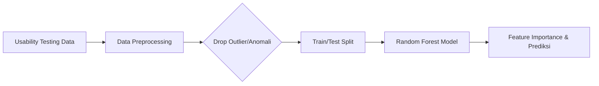
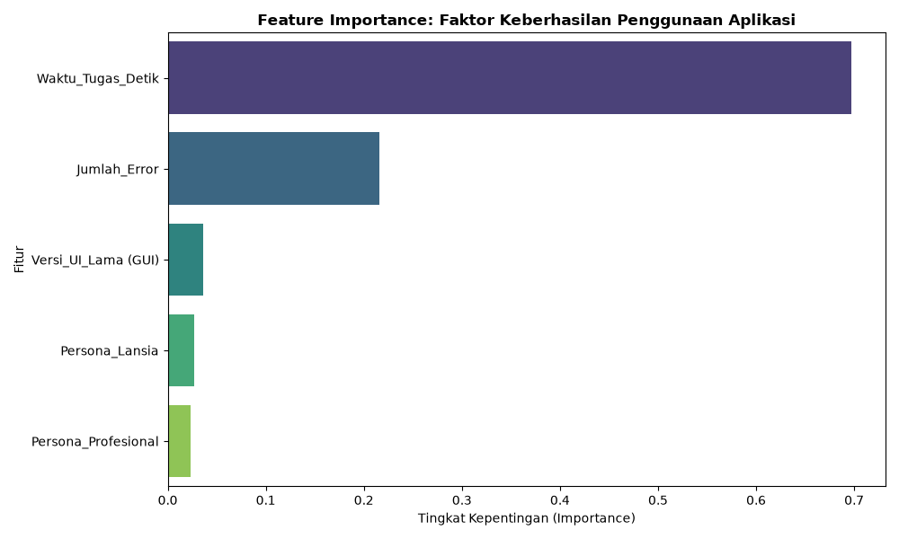

<div align="center">

<h1>🎨 UCD Usability Analytics</h1>

<h3>Platform Analitik Preskriptif untuk Evaluasi Usability dan Beban Kognitif Antarmuka</h3>

*Dari pengujian usability ➔ identifikasi beban kognitif ➔ prediksi kesuksesan tugas ➔ rekomendasi desain berbasis data.*

<br>

<!-- BAGIAN LOGO / BADGES -->


<br><br>

<!-- MENU NAVIGASI -->
<a href="#-studi-kasus">📖 Studi Kasus</a> • 
<a href="#-piramida-analitik">🔺 Piramida Analitik</a> • 
<a href="#-arsitektur--alur-kerja">🏗️ Arsitektur</a> • 
<a href="#-cara-menjalankan">🚀 Cara Menjalankan</a> • 
<a href="#-contoh-output">📊 Contoh Output</a>

</div>

<br>

## 📖 Studi Kasus

Proyek ini mengadopsi konsep **Interaksi Manusia Komputer (IMK)** dan filosofi **User-Centered Design (UCD)** yang digabungkan dengan pemodelan analitik data.

**Konteks Masalah:**
Aplikasi layanan "SehatInklusif" baru saja melakukan pembaruan antarmuka (*redesign*) dari versi konvensional (*GUI lama*) ke antarmuka baru yang diklaim lebih inklusif. Namun, tim produk perlu membuktikan secara empiris apakah pembaruan ini benar-benar menurunkan *Extraneous Load* (beban kognitif akibat desain yang buruk) dan mempercepat berbagai target persona pengguna (Lansia, Gen Z, Profesional) dalam menyelesaikan tugas utama di aplikasi.

**Tujuan Solusi:**
Membangun sebuah **Sistem Evaluasi Usability & Prediksi Kesuksesan Tugas** berbasis *Machine Learning* untuk memprediksi probabilitas keberhasilan pengguna (*Task Success*) berdasarkan metrik waktu tempuh dan jumlah *error*, serta mengidentifikasi faktor fitur apa yang memegang bobot terbesar dalam menentukan keberhasilan UX.

## 🔺 Piramida Analitik

Proyek ini menerapkan tahapan analisis *end-to-end* untuk evaluasi pengalaman pengguna (UX):

1. **Deskriptif (Apa yang terjadi?):** Mengukur rata-rata waktu penyelesaian tugas (`Waktu_Tugas_Detik`) dan frekuensi kesalahan klik (`Jumlah_Error`) pada antarmuka aplikasi.
2. **Diagnostik (Mengapa terjadi?):** Tingginya *Extraneous Load* dan alur navigasi yang kompleks menyebabkan peningkatan kesalahan interaksi dan penurunan *success rate*.
3. **Prediktif (Apa yang akan terjadi?):** Model `RandomForestClassifier` memprediksi probabilitas kesuksesan tugas pengguna (Gagal = 0, Sukses = 1) berdasarkan pola interaksinya.
4. **Preskriptif (Apa yang harus dilakukan?):** Menghasilkan bobot *Feature Importance* untuk merekomendasikan tim UI/UX agar memangkas langkah navigasi (*Overview First*) dan memperbesar ukuran target tombol bagi persona Lansia.

## 🏗️ Arsitektur & Alur Kerja

Sistem ini memproses data pengujian *usability*, membersihkan anomali interaksi (seperti pengguna yang *AFK* atau tertinggal saat pengujian *remote*), serta melakukan pengkodean variabel kategorikal persona.



- **Dataset:** Data simulasi 500 sampel interaksi *usability testing* ([`usability_testing_data.csv`](usability_testing_data.csv)).
- **Algoritma:** Random Forest Classifier (*Ensemble Learning*).
- **Hasil:** File dataset CSV terkonfigurasi dan plot grafik kepentingan fitur ([`feature_importance.png`](feature_importance.png)).

## 🚀 Cara Menjalankan

Ikuti langkah-langkah berikut untuk menjalankan *script* analitik di komputer lokal Anda:

**1. Clone Repositori**
```bash
git clone https://github.com/USERNAME_GITHUB_ANDA/ucd-usability-testing.git
cd ucd-usability-testing
```

**2. Buat & Aktifkan Virtual Environment**
```bash
python -m venv .venv
```

**3. Instalasi Library Dependencies**
```bash
.venv\Scripts\python -m pip install pandas numpy scikit-learn matplotlib seaborn
```
*(Catatan: Jika menggunakan `uv`, Anda bisa menginstal langsung via `uv pip install pandas numpy scikit-learn matplotlib seaborn`)*

**4. Eksekusi Script Utama**
```bash
.venv\Scripts\python main.py
```

## 📊 Contoh Output

 Saat *script* `main.py` dijalankan, sistem akan mencetak metrik performa model ke terminal dan secara otomatis menyimpan dataset beserta grafik visualisasi di dalam folder proyek.

### 1. Terminal Output & Klasifikasi Model
```text
Akurasi Model Berhasil Dihitung: 0.6737

Classification Report:
              precision    recall  f1-score   support

           0       0.36      0.43      0.39        23
           1       0.81      0.75      0.78        72

    accuracy                           0.67        95
   macro avg       0.58      0.59      0.58        95
weighted avg       0.70      0.67      0.68        95

Kepentingan Fitur (Feature Importance):
 Waktu_Tugas_Detik      0.697132
 Jumlah_Error           0.216225
 Versi_UI_Lama (GUI)    0.035962
 Persona_Lansia         0.027092
 Persona_Profesional    0.023589

SUKSES! File CSV dan Gambar PNG telah berhasil dibuat di folder proyek.
```

### 2. Output Gambar Visualisasi (`feature_importance.png`)
Berikut adalah hasil visualisasi faktor penentu utama keberhasilan penggunaan antarmuka yang diekspor otomatis:

<div align="center">
  
</div>

### 3. Output Data Tergenerasi (`usability_testing_data.csv`)
File [`usability_testing_data.csv`](usability_testing_data.csv) berisi sampel data mentah hasil pembersihan anomali:

| User_ID | Persona | Versi_UI | Waktu_Tugas_Detik | Jumlah_Error | Sukses |
| :--- | :--- | :--- | :--- | :--- | :--- |
| 1 | Gen Z | Baru (Inklusif) | 18.45 | 0 | 1 |
| 2 | Lansia | Lama (GUI) | 68.12 | 4 | 0 |
| 3 | Profesional | Baru (Inklusif) | 22.30 | 1 | 1 |
| 4 | Lansia | Baru (Inklusif) | 35.10 | 1 | 1 |
